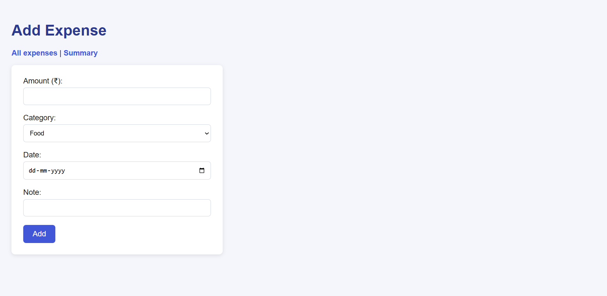
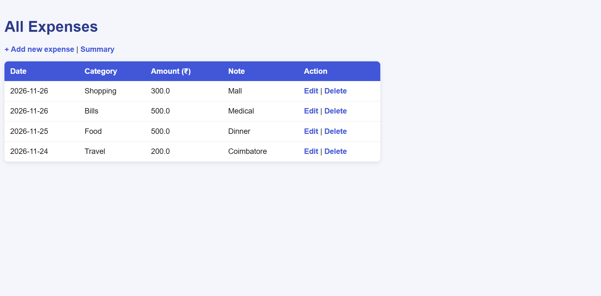
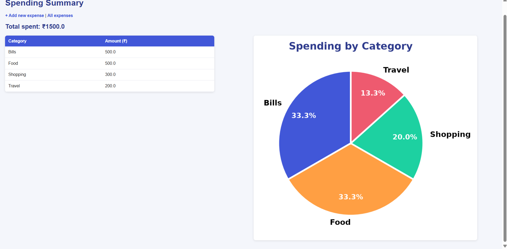

# Expense Tracker

A web app built with Python and Flask to record daily expenses and see where the money goes.

## Features
- Add an expense with amount, category, date and note
- View all expenses in a table
- Edit and delete expenses (with a confirmation popup)
- Summary page with total spending, category-wise totals and a pie chart

## Screenshots

### Add Expense

### All Expenses

### Summary

## Tools Used
- Python, Flask
- SQLite (database)
- Pandas (calculations)
- Matplotlib (pie chart)
- HTML and CSS

## How to Run
1. Install Python 3.10 or newer
2. Open the project folder in a terminal and run:
   pip install flask pandas matplotlib
3. Start the app:
   python app.py
4. Open http://127.0.0.1:5000 in your browser

## Author
Shalini A